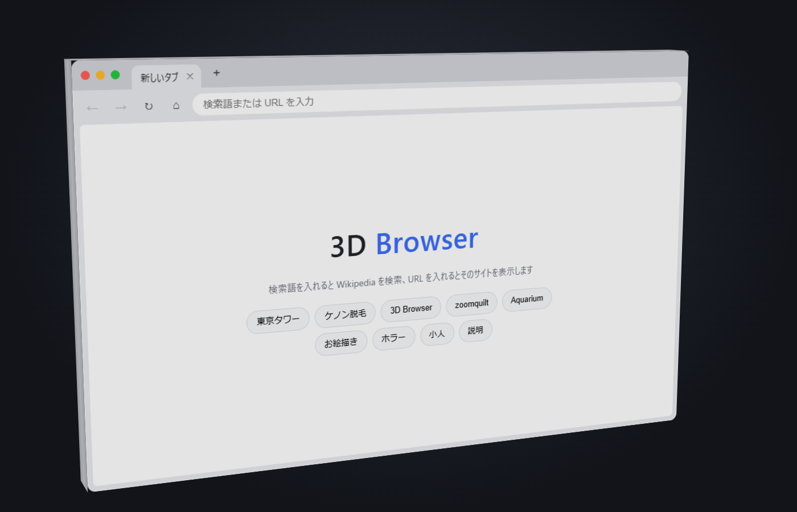
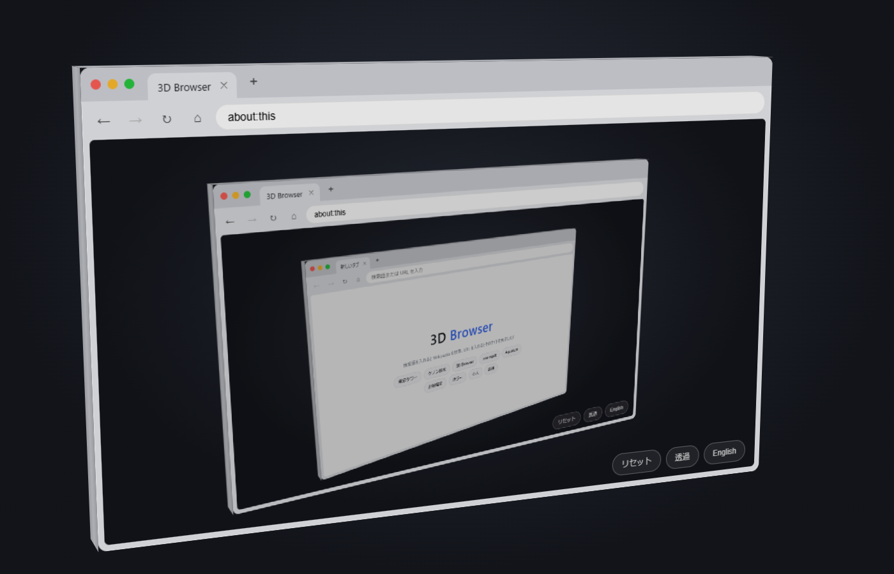
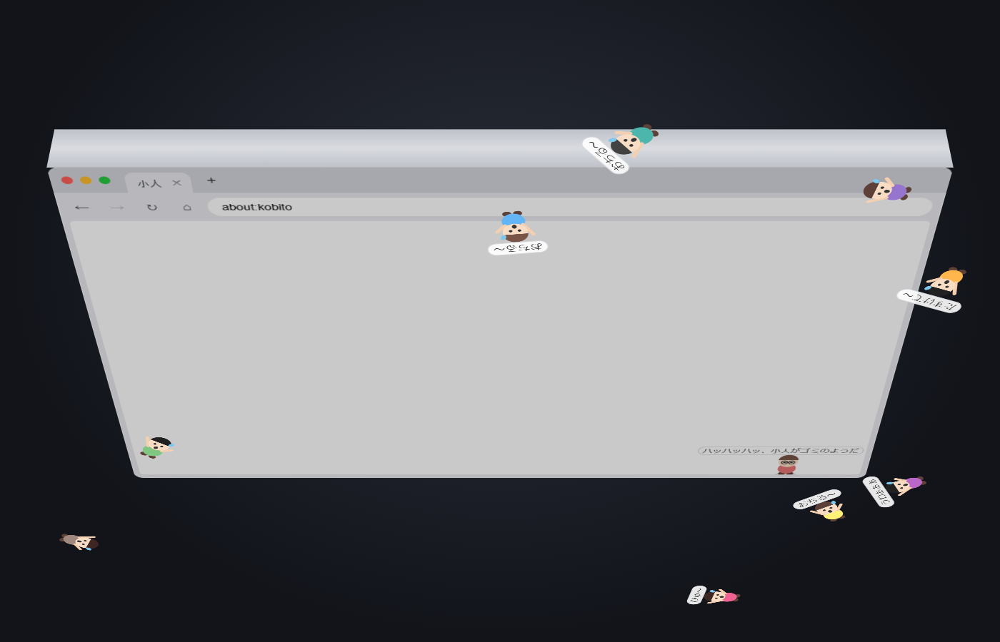
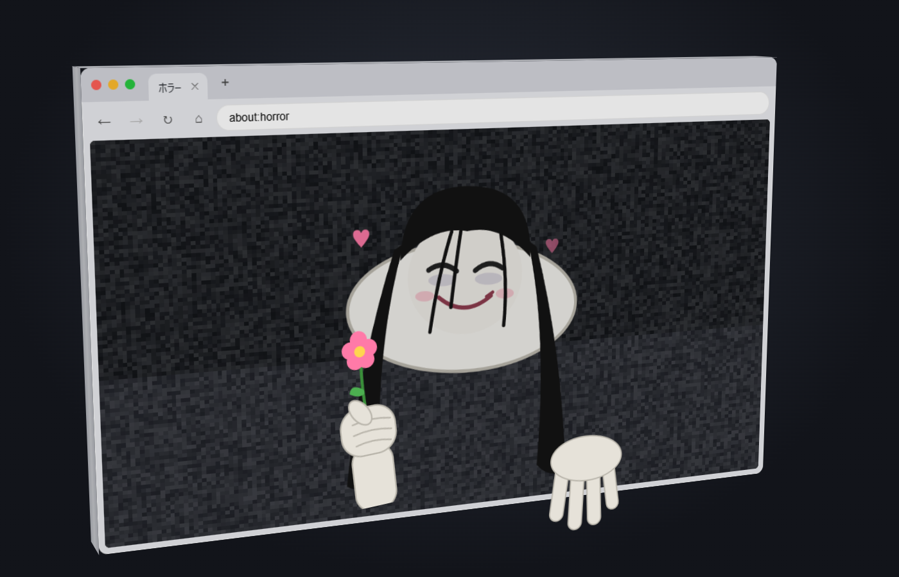

# 3D Browser

ブラウザの中に、厚みのある 3D のブラウザを表示する Web アプリです。
やたら縦に長いケノン脱毛(未購入)のサイトからひらめいて作りました。

**▶ https://3dbrowser.cantic.org/**

A web app that shows a thick, rotatable 3D browser inside your browser.



| ブラウザの中のブラウザの中の… (`about:this`) | 小人 (`about:kobito`) |
|---|---|
|  |  |
| **ちょっと怖い？ (`about:horror`)** | |
|  | |

## できること

- 箱の形をしたブラウザを、ドラッグや画面下の操作パネルで回す・拡大縮小する
- 画面の外側の背景を円を描くようにドラッグ（スマホは 2 本指でひねる、パネルの ⟲ ⟳）で、画面に平行に回す
- 操作パネルのロック（3 つ同時にも使える。「リセット」で全部止まる）
  - ⟲ ⟳ / ＋ − を長押しするとリングが伸びて速さが 3 段階で上がり、離すとその速さで続ける（もう一度押すと止まる）。＋ − は極大と極小の間をループし、突き抜けて遠くからまた現れる
  - スティックを倒したまま 2 秒じっとして離すと、その位置（速さ）のまま回り続ける（スティックに触れると止まる）
- 右下の角をドラッグしてブラウザの大きさを変える（どの面でも。ブラウザにしていない面でもよい。側面・上下の面では箱の厚みも変わり、最大で立方体まで）。黄の丸で最小化、緑の丸で最大化。右下の「サイズ」からスマホ・タブレット・ワイドなどの大きさを選べる
- アドレスバーに `about:tall` と入れると、やたら縦に長いケノン脱毛のサイトを縦に長いブラウザで一望できる
- 前面だけでなく、側面・背面もクリックでブラウザにできる（タブはドラッグで別の面へ移動）
- 検索語は Wikipedia を検索、URL はそのサイトを表示（iframe）。YouTube の動画ページの URL は埋め込みに変えて再生できる（公開サイトのような https で開いたとき）
- 「透過」で反対側の面を透かして見る（長押しでスライダーが出て、上下に動かすと透け具合を変えられる。動かさずに離すとスライダーは出たままになり、直接ドラッグできる。「リセット」で透過も透け具合も元に戻る）。透過中は、小人とお絵描きのページはガラスのように背景が透明になり、描いたものだけが見える
- 日本語 / English の切り替え

### 内蔵ページ

| アドレス | 内容 |
|---|---|
| `about:this` | この 3D Browser 自身（ブラウザの中のブラウザの中の…） |
| `about:draw` | お絵描き。描いた線を蝶のように飛ばせる |
| `about:horror` | ちょっと怖い？（Esc でスキップ） |
| `about:kobito` | 小人（Tiny Folks）が暮らしている。回すとあたふたする。何もない所をドラッグすると線が引けて、小人はその上を歩く（線はドラッグで移動、ダブルクリックで消す。すばやく振り上げると乗っている小人が飛んでいく） |
| `about:info` | 操作方法などの説明 |

お絵描き・ホラー・小人はプラグイン（`plugins/*.js`）になっています。作り方は下の「内蔵ページを追加する」を見てください。

## 注意

iframe を使っているため、埋め込みを拒否している多くのサイト（Google、X など）は中に表示されません。

## 動かし方

`index.html` と `plugins/` フォルダだけで動きます。外部ライブラリは不要なので、`index.html` をブラウザで直接開くか、好きな静的サーバーで配信してください。

## 内蔵ページを追加する

`plugins/` に JS ファイルを置いて `node build-plugins.mjs` を実行すると、`index.html` に読み込みが追加され、`about:<id>` で開けるようになります（スタートページのボタンと説明ページの一覧にも出ます）。

```js
// plugins/hello.js
B3D.registerPage({
  id: 'hello',                          // about:hello で開く
  title: 'hello',                       // タブ名 (strings のキー)
  info: 'helloInfo',                    // 説明ページの一覧に出す説明
  menu: true,                           // スタートページと説明ページに並べる
  strings: { hello: ['こんにちは', 'Hello'], helloInfo: ['あいさつ', 'Greetings'] },  // [日本語, English]
  css: `.hello { padding: 40px; font-size: 32px; }`,
  render(tab, api) {                    // ページの中身を作る
    const el = document.createElement('div');
    el.className = 'hello';
    el.textContent = api.t('hello');
    tab.pane.appendChild(el);
  },
});
```

`api` から本体の機能を使えます（面の向き・重力、面の外への 3D 表示、毎フレームの処理、ページ間のアイテムの受け渡しなど）。中身は `index.html` の `pageApi` を見てください。

## デプロイ (Cloudflare)

```
node deploy.mjs            # 公開する
node deploy.mjs --dry-run  # アップロードせずに確認だけ
```

`node build-plugins.mjs` を実行してから、`index.html`・`plugins/`・`LICENSE` を `dist/` に集めて、`wrangler deploy` で Cloudflare Workers に配信します（設定は `wrangler.toml`）。

## ライセンス

[MIT License](LICENSE)

2026 made by cantik with [Claude Code](https://claude.com/claude-code)
